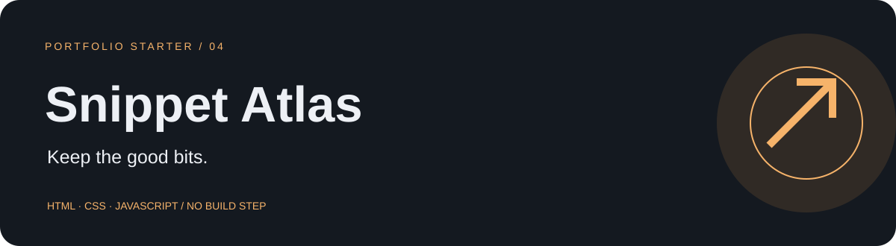

# Snippet Atlas

A searchable code notebook with tags, favorites and JSON export.

**Status:** Working local-first web app. Responsive, dependency-free, and ready for GitHub Pages. No backend or account system.

## Why build it?

Create a tool you can use while learning and building your other projects.

**Design:** Dark code panels, warm amber accents and compact tag labels.

**Practice:** Search, CRUD, text escaping, clipboard access and JSON export.

## Working features

- Create, edit and delete code snippets.
- Search titles, code and comma-separated tags.
- Filter by language or favorites.
- Copy plain code and export your collection as JSON.

- Download and restore versioned JSON backups, with validation before replacement.
- Use the app offline after the first successful online visit (HTTPS or localhost).

## Run it

1. Clone or download this repository.
2. Open the repository folder in VS Code using **File → Open Folder**.
3. Double-click `index.html` in File Explorer to launch it in a current browser.

There is no dependency installation, API key, paid service or build step. All assets are local. If your browser restricts storage or clipboard access on `file://`, use a local static server. If Python is already installed on Windows, open a terminal in this folder and run:

```powershell
py -m http.server 5500 --bind 127.0.0.1
```

Then visit `http://localhost:5500`. Keep using the same browser and address to keep the same saved data. Changing ports, browsers or origins creates a separate storage area.

## A quick demo

Save a snippet → find it by tag → edit it → copy the code.

## File guide

| File | Purpose |
|---|---|
| `index.html` | Document shell and local script/style references |
| `meta.js` | App name, tagline, description and initials |
| `styles.css` | Theme variables, responsive components and app layout |
| `common.js` | Storage, safe text escaping, dialogs, downloads and shared UI |
| `app.js` | App state, sample data, rendering and event handlers |
| `data-tools.js` | Versioned backup, validation, restore and offline status |
| `sw.js` / `manifest.webmanifest` | Scoped offline cache and web app metadata |
| `banner.svg` / `favicon.svg` | Editable vector branding |
| `ROADMAP.md` | Three follow-up tasks and a build prompt |
| `MY_CHANGES.md` | A place to record your own work |
| `.nojekyll` | Allows straightforward static publishing on GitHub Pages |

Every folder is self-contained. It does not depend on another starter folder.

## Make it your own

1. Change the name/tagline in `meta.js` and the accent colors at the top of `styles.css`.
2. Replace demo content in the `seed` object in `app.js`.
3. Implement one item from `ROADMAP.md` and record the change in `MY_CHANGES.md`.
4. Replace this section with your own problem statement, screenshots and development notes.

## Deployment

GitHub Pages serves this repository's `main` branch from `/(root)`. All assets use relative paths, so the app works from its repository subpath. No API keys or build commands are required.

For future releases, update the cache version in `sw.js` when changing the offline shell. The service worker only caches this app's files and only clears older caches with this app's prefix.

## Scope and data

Code is displayed as escaped plain text and never executed. There is no syntax highlighting or cloud sync. JSON backups can be restored through Your data. Clipboard access may require a secure context; a legacy copy fallback is included. Use your own snippet content when customizing.

Sample data is fictional. Changes stay in `localStorage` in this browser, are not encrypted, and do not sync across devices. Clearing browser data removes them. Multiple tabs do not coordinate edits. Use **Your data → Download backup** to export a version 1 JSON snapshot, then choose that file under **Restore** on another device. Restore validates the app name, version, fields, ranges and record references, previews the record count, and asks before replacing local data. Back up your current data first. Focus timers restore paused. Files larger than 2 MB are rejected. **Reset demo** replaces the saved data after confirmation. Browser data is separate from the source files you upload to GitHub.

## Next steps

1. Add merge-on-import with a per-snippet conflict preview (restore currently replaces the collection).
2. Add optional syntax highlighting.
3. Build an authenticated API for private cross-device sync.

## Validation

See `CHECKS.md` for completed checks and the short manual checklist. Native keyboard controls, form labels, visible focus styles and responsive CSS are included. Check the manual checklist when you customize the app or test it on a new browser.
